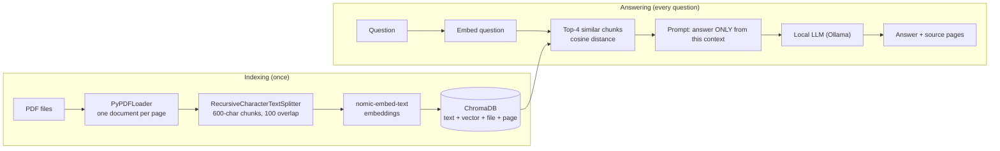

# Document Q&A Assistant with RAG and Vector Embeddings

Answers questions **strictly from the attached PDF documents** and cites the **file and page** each answer
came from. Runs fully locally and for free: [Ollama](https://ollama.com) for the models, ChromaDB for the
vector store, LangChain for loading, splitting and model access.

## How it works



1. **Load**: each PDF page becomes a document that remembers its file name and page number.
2. **Chunk**: pages are cut into overlapping pieces, so each piece holds one idea and facts at a boundary are not lost.
3. **Embed and store**: each chunk is turned into a vector that captures its meaning and stored in ChromaDB with its page number.
4. **Retrieve**: the question is embedded the same way and the closest chunks are found.
5. **Answer**: the model gets only those chunks and a strict instruction to answer from them or say it doesn't know.
6. **Cite**: the index is searched again using the question *and the answer* as the query, and only the retrieved chunks closest to that are cited. Nothing is cited when the model refuses.

## Setup

1. Install Python 3.10+ and [Ollama](https://ollama.com/download).
2. Download the models:
   ```bash
   ollama pull nomic-embed-text
   ollama pull qwen2.5:7b
   ```
   (`llama3.2:3b` is a faster, lighter alternative.)
3. Install the dependencies:
   ```bash
   python -m venv venv
   venv\Scripts\activate          # Windows (macOS/Linux: source venv/bin/activate)
   pip install -r requirements.txt
   ```

## Usage

```bash
python ask.py index                                          # build the index from the PDFs in docs/
python ask.py ask "How many paid annual leave days do full-time employees get?"
python ask.py ask "What does error code E2 mean?" --show-chunks   # also print the retrieved chunks
python ask.py chat                                           # interactive session
python evaluate.py                                           # run the 21 test questions
```

Put your own PDFs into `docs/` and run `python ask.py index` again. The index is rebuilt from scratch each time.
The two sample PDFs are **fictional** (a company handbook and a pump manual), so a model cannot answer
from its training data. If it answers correctly, the answer really came from the retrieved text.

Example:
```
Question: How many working days per year can employees work remotely from abroad?
Up to 20 working days per calendar year, with prior approval from the line manager.

Sources:
  - Aurelia_Robotics_Employee_Handbook.pdf, page 2
```

## Evaluation

`tests/questions.json` holds 21 questions: 14 answerable ones with their expected page, and 7 that the
documents do **not** answer (including a general-knowledge question and some deliberately tricky ones such as
seawater, where the manual only mentions "corrosive liquids"). `evaluate.py` measures:

- **Retrieval hit rate**: were the right file and page among the retrieved chunks?
- **Correct citations**: are the pages shown under the answer exactly the right ones?
- **Correct answers**: does the answer contain the expected facts?
- **Correct refusals**: did the model say "I don't know" instead of inventing an answer?

Results (CPU only, 16 GB RAM):

| Model | Retrieval hit rate | Correct answers | Correct citations | Correct refusals |
|---|---|---|---|---|
| qwen2.5:7b | 14/14 | 14/14 | 13/14 | 7/7 |
| llama3.2:3b | 14/14 | 14/14 | 13/14 | 7/7 |

### Findings

- Both models answered every question correctly and refused all 7 questions the documents do not cover,
  including tricky ones (seawater, pets). The strict prompt does the refusing; chunk distance alone could
  not separate answerable from unanswerable questions (best distances 0.11-0.43 vs 0.25-0.50).
- Citations were first chosen by similarity to the answer only. The 3B model's very short answers
  ("EUR 450.") found the wrong page in 5 of 14 cases (9/14 correct). Searching with the question *and*
  the answer raised this to 13/14.
- The remaining miss: for "How much water is needed to prime the pump?", the correct page and a neighbouring
  page were cited together because their chunks scored almost identically.
- The test set is small (21 questions) and its facts are stated directly, so it shows the pipeline works but
  is not a benchmark; harder multi-fact questions would likely separate the models.
- Time per question varied from about 2 to 40 seconds on CPU depending on what else was running.

## Design choices

- **Strict prompt + refusal sentence**: the model must answer only from the context or reply with a fixed sentence.
  Refusals are detected and shown without sources, so the app never cites pages for an answer it didn't give.
- **Answer-based citations**: ranking sources by similarity to the question is unreliable for short queries (for example "What does error code E2 mean?" ranked an unrelated page first), so citations are chosen by how well each retrieved chunk matches the generated answer (together with the question, because very short answers like "EUR 450." are too vague to search with).
- **Distance threshold**: chunks that are too far from the question are dropped; if nothing is left the model is not called.
- **Embedding prefixes**: `nomic-embed-text` works better with `search_document:` / `search_query:` prefixes, so they are added automatically.
- **Cosine distance** in ChromaDB makes scores easy to interpret (0 means identical).
- **Page numbers are 1-based** and match the PDF viewer's page index.

## Known limitations

- Scanned PDFs (images of text) are not supported; there is no OCR.
- Citations are an approximation (which retrieved chunk is most similar to the answer), not a guarantee of what the model read.
- Retrieval ranking can be imperfect for very short queries such as error codes; the right chunk is usually still in the top 4.
- The PDF text extractor sometimes drops spaces in some PDFs ("Leaveand Time Off"); this rarely affects results.
- Tables and multi-column layouts can be extracted in a scrambled order by the PDF reader.
- Printed page labels can differ from PDF page indices (for example when a document has a cover page); this project cites the PDF index.
- A 7B model on CPU needs roughly 20-60 seconds per answer.
- Small models can occasionally ignore the "answer only from the context" rule on tricky questions.

## Project structure

```
rag.py             pipeline: load, split, embed, store, retrieve, answer
ask.py             command-line interface (index / ask / chat)
evaluate.py        runs the test questions and reports quality
tests/             questions.json and saved results
docs/              sample PDFs (fictional) and the script that generated them
chroma_db/         the vector index (created by `ask.py index`, not committed)
```
