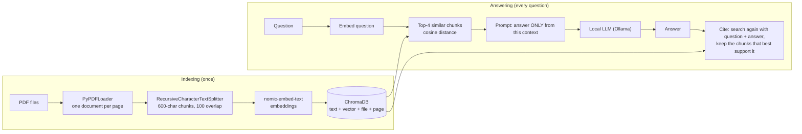

# Task 2: Document Q&A Assistant with RAG and Vector Embeddings

Answers questions **strictly from your own PDF documents** and cites the **file and page** each answer came from.
It refuses to answer when the documents don't contain the information. Everything runs locally and for free:
[Ollama](https://ollama.com) for the models, ChromaDB for the vector store, LangChain for loading, splitting and model access.

## How it works



1. **Load**: each PDF page becomes a document that remembers its file name and page number (1-based, like a PDF viewer).
2. **Chunk**: pages are cut into overlapping pieces, so each piece holds one idea and facts at a boundary are not lost.
3. **Embed and store**: each chunk becomes a vector that captures its meaning and is stored in ChromaDB with its page number.
4. **Retrieve**: the question is embedded the same way and the closest chunks are found.
5. **Answer**: the model receives only those chunks and a strict instruction to answer from them, or reply "I don't know based on the provided documents."
6. **Cite**: the index is searched again with the question *and the answer*, and only the retrieved chunks that best match are cited. Nothing is cited when the model refuses.

## Setup

1. Install Python 3.10+ and [Ollama](https://ollama.com/download).
2. Download the models:
   ```bash
   ollama pull nomic-embed-text
   ollama pull qwen2.5:7b
   ```
   (`llama3.2:3b` is a faster, lighter alternative.)
3. Install the dependencies:
   ```bash
   python -m venv venv
   venv\Scripts\activate          # Windows (macOS/Linux: source venv/bin/activate)
   python -m pip install -r requirements.txt
   ```

## Usage

```bash
python ask.py index                                          # build the index from the PDFs in docs/
python ask.py ask "How many paid annual leave days do full-time employees get?"
python ask.py ask "What does error code E2 mean?" --show-chunks   # also print the retrieved chunks
python ask.py chat                                           # interactive session
python evaluate.py                                           # run the 21 test questions
python evaluate.py --model llama3.2:3b                       # compare another model
```

Put your own PDFs in `docs/` and run `python ask.py index` again; the index is rebuilt from scratch each time.
The two sample PDFs are **fictional** (a company handbook and a pump manual), so a model cannot answer from its
training data. If it answers correctly, the answer really came from the retrieved text.

Example:
```
Question: How many working days per year can employees work remotely from abroad?
Employees can work remotely from abroad for up to 20 working days per calendar year, with prior approval from the line manager.

Sources:
  - Aurelia_Robotics_Employee_Handbook.pdf, page 2
```

## Evaluation

`tests/questions.json` has 21 questions: 14 answerable ones with their expected file and page, and 7 that the
documents do **not** answer (a general-knowledge question and several tricky ones, such as seawater, where the
manual only mentions "corrosive liquids"). `evaluate.py` measures:

- **Retrieval hit rate**: were the right file and page among the retrieved chunks?
- **Correct answers**: does the answer contain the expected facts?
- **Correct citations**: are the pages shown under the answer exactly the right ones?
- **Correct refusals**: did the model say "I don't know" instead of inventing an answer?

CPU only, 16 GB RAM, full tables in `tests/results_*.md`:

| Model | Retrieval hit rate | Correct answers | Correct citations | Correct refusals |
|---|---|---|---|---|
| qwen2.5:7b | 14/14 | 14/14 | 13/14 | 7/7 |
| llama3.2:3b | 14/14 | 14/14 | 13/14 | 7/7 |

### Findings

- Both models answered every question correctly and refused all 7 questions the documents do not cover.
  The strict prompt does the refusing: chunk distance alone could not separate answerable from unanswerable
  questions (best distances 0.11-0.43 vs 0.25-0.50).
- Citations were first chosen by similarity to the answer only. The 3B model's very short answers ("EUR 450.")
  found the wrong page in 5 of 14 cases (9/14 correct). Searching with the question *and* the answer raised this to 13/14.
- Ranking sources by similarity to the *question* is unreliable for short queries: "What does error code E2 mean?"
  ranked an unrelated page first, although the right chunk was still within the top 4.
- The one remaining citation miss ("How much water is needed to prime the pump?") cites the correct page together with a
  neighbouring one, because their chunks scored almost identically (0.28 vs 0.29).
- The test set is small and its facts are stated directly, so it shows that the pipeline works but is not a benchmark.
  Harder questions that combine several facts would likely separate the models.

## Design choices

- **Strict prompt + fixed refusal sentence**: refusals are detected and shown without sources, so the app never cites pages for an answer it didn't give.
- **Answer-based citations**: see the findings above.
- **Distance threshold** (`MAX_DISTANCE = 0.6`): chunks that are far from the question are dropped; if none remain, the model is not called.
- **Embedding prefixes**: `nomic-embed-text` works better with `search_document:` / `search_query:` prefixes, which are added automatically.
- **Cosine distance** in ChromaDB makes scores easy to interpret (0 means identical).

## Known limitations

- Scanned PDFs (images of text) are not supported; there is no OCR.
- Citations are an approximation (the retrieved chunk most similar to the answer), not proof of what the model read.
- The PDF text extractor sometimes drops spaces ("Leaveand Time Off"); this rarely affects results.
- Tables and multi-column layouts can be extracted in a scrambled order.
- Printed page labels can differ from PDF page indices (for example when a document has a cover page); this project cites the PDF index.
- Small models can occasionally ignore the "answer only from the context" rule on tricky questions.
- Time per answer on CPU ranged from about 2 to 40 seconds, depending on the model and on what else was running.

## Project structure

```
rag.py             pipeline: load, split, embed, store, retrieve, answer, cite
ask.py             command-line interface (index / ask / chat)
evaluate.py        runs the test questions and reports quality
tests/             questions.json and saved results
docs/              sample PDFs (fictional) and the script that generated them
chroma_db/         the vector index (created by `ask.py index`, not committed)
```
