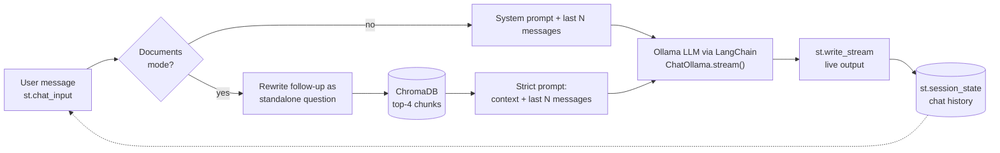

# Interactive AI Chatbot with Streamlit

A browser chat app that streams answers token by token, remembers the conversation, and can switch to
**answering strictly from your own PDF documents** with the source page shown under every answer.
Everything runs locally and for free with [Ollama](https://ollama.com); no API key is needed.


## Features

- **Streaming output**: the answer appears word by word (`st.write_stream`).
- **Conversation memory**: the chat history is kept in `st.session_state` and the most recent messages are re-sent to the model on every turn, because the model itself has no memory. The number of remembered messages is adjustable.
- **Session management**: a "New chat" button clears the conversation; each browser session has its own history.
- **Document Q&A (RAG)**: upload PDFs, they are chunked, embedded and stored in ChromaDB; answers come only from the retrieved passages, and sources (file, page, passage) are shown in an expander.
- **Follow-up questions work in document mode**: before searching, a follow-up like "and for part-time staff?" is rewritten into a standalone question using the chat history.
- **Honest refusals**: if the documents don't contain the answer, the bot says so and shows no sources.
- **Settings**: model picker (from your installed Ollama models), temperature, memory size, system prompt.

## Architecture



`rag.py` is the pipeline module from the Document Q&A project (Task 2), copied here so this folder is self-contained.

## Setup

1. Install Python 3.10+ and [Ollama](https://ollama.com/download).
2. Download the models:
   ```bash
   ollama pull llama3.2:3b
   ollama pull nomic-embed-text
   ```
   For more accurate document answers you can also use `ollama pull qwen2.5:7b` and select it in the sidebar (slower on CPU).
3. Install the dependencies:
   ```bash
   python -m venv venv
   venv\Scripts\activate          # Windows (macOS/Linux: source venv/bin/activate)
   pip install -r requirements.txt
   ```
4. Run:
   ```bash
   streamlit run app.py
   ```

## Try it

1. **Normal chat**: say "My name is Sam. Remember it." then ask "What is my name?" Lower "Messages remembered" to 2 and watch it forget.
2. **Documents**: click "Index the sample documents" in the sidebar (two fictional PDFs), then ask
   "How many paid annual leave days do full-time employees get?" and expand the sources.
3. **Follow-up**: ask "And how many days can be carried over?" The sidebar caption shows how the question was rewritten.
4. **Refusal**: ask "What is the capital of France?" in document mode; the bot should say it doesn't know.
5. **Your own PDFs**: upload files and click "Index uploaded PDFs".

## Known limitations

- Chat history lives in the browser session: refreshing the page starts a new chat.
- Scanned PDFs (images) are not supported, as there is no OCR.
- Each document answer needs an extra model call to rewrite follow-up questions, which adds a few seconds on CPU.
- Indexing replaces the previous index; only one set of documents is active at a time.
- Small local models can occasionally ignore the "answer only from the documents" rule.
