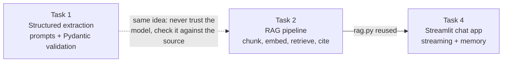

# Datheon Generative AI Internship

Three Generative AI projects built with Python, LangChain, Pydantic, ChromaDB and Streamlit.
Everything runs **locally and for free** with [Ollama](https://ollama.com): no API keys, no cloud services,
and no document ever leaves the computer.

| Task | Project | What it does | Main tools |
|---|---|---|---|
| 1 | [Structured LLM Prompt Pipeline & JSON Extractor](Structured_LLM_Prompt_Pipeline_And_JSON_Extractor) | Turns messy invoices and resumes (.txt, .pdf, .docx) into strictly validated JSON, with retries and checks against the source text | Pydantic, Ollama, Streamlit |
| 2 | [Document Q&A Assistant with RAG](Document_QA_RAG_Assistant) | Answers questions only from your PDFs, cites file and page, refuses when the documents don't contain the answer | LangChain, ChromaDB, Ollama |
| 4 | [Interactive AI Chatbot with Streamlit](Interactive_AI_Chatbot) | Streaming chat with conversation memory that can switch to answering from uploaded PDFs, with sources shown | Streamlit, LangChain, ChromaDB |

Task 3 (multi-tool agent) is not part of this repository.

## How the projects fit together



- **Task 1** shows how to make an LLM return reliable, structured data. The model's answer is validated and compared with the source text.
- **Task 2** applies the same discipline to question answering: answers come only from retrieved passages, and a test set measures retrieval, answers, citations and refusals.
- **Task 4** wraps the Task 2 pipeline in a chat interface with streaming output and memory.

## Prerequisites

1. Python 3.10 or newer
2. [Ollama](https://ollama.com/download), running in the background
3. The models (about 8 GB in total; the 3B model is optional):
   ```bash
   ollama pull qwen2.5:7b
   ollama pull llama3.2:3b
   ollama pull nomic-embed-text
   ```

Each project has its own `requirements.txt` and README with exact steps. Use a separate virtual environment per project:

```bash
cd <project folder>
python -m venv venv
venv\Scripts\activate            # Windows  (macOS/Linux: source venv/bin/activate)
python -m pip install -r requirements.txt
```

## Repository structure

```
Datheon_Generative_AI_Internship/
├── Structured_LLM_Prompt_Pipeline_And_JSON_Extractor/   Task 1
├── Document_QA_RAG_Assistant/                           Task 2
├── Interactive_AI_Chatbot/                              Task 4
└── README.md
```

## Notes

- All measurements were made on a CPU-only laptop with 16 GB of RAM. A 7B model takes seconds to a minute per answer; the 3B model is faster.
- All sample documents (invoices, resumes, handbook, manual) are **fictional**. No real personal data is included.
- The tests in each project are small and use directly stated facts. They show that the pipelines work and where they fail; they are not benchmarks.

## Demo

LinkedIn walkthrough: https://lnkd.in/p/epq-9VeG
