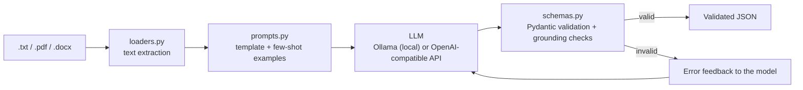

# Structured LLM Prompt Pipeline & JSON Extractor

Turns messy, unstructured documents (invoices and resumes, as .txt, .pdf or .docx) into
**strictly validated JSON** using an LLM. Runs fully locally and for free with
[Ollama](https://ollama.com), and optionally against any OpenAI-compatible API.

## Why validation matters

LLMs return *plausible* text, not guaranteed-correct data. During development this pipeline caught:

- a model that listed VAT as a purchased item,
- a model that **invented a total** to make the arithmetic work,
- a model that read "200 pcs" in a description as the quantity,
- a model that returned `email: null` when the email was in the text.
- a model that **copied an employer from a few-shot example** into a CV that listed no jobs
  (example leakage), caught because every company name must appear in the source text,
- a model that put a **grade ("75.09") and a language level ("B1") into the graduation-year field**,
- a model that wrote the **text** "null" instead of a real null.

Each failure is now caught by a validator and sent back to the model for correction.

## Architecture



1. **Structured output**: the JSON schema is sent to the model so it returns the right shape.
2. **Pydantic validation**: types, date formats, 3-letter currency codes, valid emails.
3. **Business rules**: line items - discount + tax must equal the total.
4. **Grounding checks**: every amount, invoice number, email and company must actually appear in the
   source text, so the model cannot invent or "fix" values.
5. **Retry loop**: on failure, the exact error is fed back to the model (max 3 attempts), then the
   pipeline fails with a clear message instead of returning bad data.
6. **Safety limits**: per-call timeout and output-token cap so a stuck model cannot hang the program.

## Setup

1. Install Python 3.10+ and [Ollama](https://ollama.com/download).
2. Download a model: `ollama pull qwen2.5:7b` (about 5 GB; use `llama3.2:3b` for a faster, lighter option).
3. Install dependencies:
```bash
   python -m venv venv
   venv\Scripts\activate        # Windows  (macOS/Linux: source venv/bin/activate)
   pip install -r requirements.txt
```

## Usage

```bash
python extractor.py --file samples/invoices/invoice2.txt --type invoice
python extractor.py --file samples/resumes/resume2.pdf --type resume --output result.json
python extractor.py --file samples/resumes/resume1.txt --type resume --model llama3.2:3b
python run_samples.py                      # runs every sample and writes outputs/<model>/summary.md
```

### Using an API instead of Ollama (optional)

```bash
pip install openai
set OPENAI_API_KEY=your_key            # Windows (macOS/Linux: export OPENAI_API_KEY=...)
python extractor.py --file samples/invoices/invoice1.txt --provider openai --model gpt-4o-mini
```

For Gemini, set `OPENAI_BASE_URL=https://generativelanguage.googleapis.com/v1beta/openai/` and use your
Gemini key as `OPENAI_API_KEY`. **Note:** the API path is implemented but was not tested by the author
(no API access in the author's region); the Ollama path is fully tested.

## Example

Input:
```
INVOICE #2291 - Brightline Supplies Ltd.
Date: March 4th, 2026
3x Office chairs @ 85.00 each... 255.00
1 Standing desk 310
VAT 21%: 118.65   TOTAL: 683.65 EUR
```

Output:
```json
{
  "vendor": "Brightline Supplies Ltd.",
  "invoice_number": "2291",
  "date": "2026-03-04",
  "currency": "EUR",
  "line_items": [
    {"description": "Office chairs", "quantity": 3.0, "unit_price": 85.0},
    {"description": "Standing desk", "quantity": 1.0, "unit_price": 310.0}
  ],
  "discount": 0.0,
  "tax": 118.65,
  "total": 683.65
}
```

## Results on the 10 sample documents (CPU only, 16 GB RAM)

| Model | Passed | Time per document |
|---|---|---|
| llama3.2:3b | 9/10 | 9-22 s |
| qwen2.5:7b | 10/10 | 22-53 s |

`broken_total.txt` is intentionally inconsistent and is **expected to be rejected**; both models pass
that test. The 3B model failed `resume2.txt` by repeatedly returning `email: null`, and earlier
misread a pack size as a quantity on `invoice2`.

## Known limitations

- Scanned (image-only) PDFs are not supported; there is no OCR.
- Small local models can still miss items on unusual layouts; larger models are more reliable.
- The sample set is small and synthetic; it is not a statistical benchmark.
- Supports two document types (invoice, resume). New types need a schema and a prompt config.
- a model that **copied an employer from a few-shot example** into a CV that listed no jobs
  (example leakage), caught because every company name must appear in the source text,
- a model that put a **grade ("75.09") and a language level ("B1") into the graduation-year field**,
- a model that wrote the **text** "null" instead of a real null.

## Project structure

```
schemas.py     Pydantic models and validators
prompts.py     prompt templates and few-shot examples
loaders.py     .txt / .pdf / .docx text extraction
extractor.py   LLM calls, retry loop, command-line interface
run_samples.py batch runner and model comparison
samples/       fake invoices and resumes (no real personal data)
outputs/       saved results per model
```

## Web UI (Streamlit)

```bash
streamlit run app.py
```

Choose a document type, pick a sample, upload a file or paste text, and view the validated result
as tables, with a JSON download and a log of any validation retries.