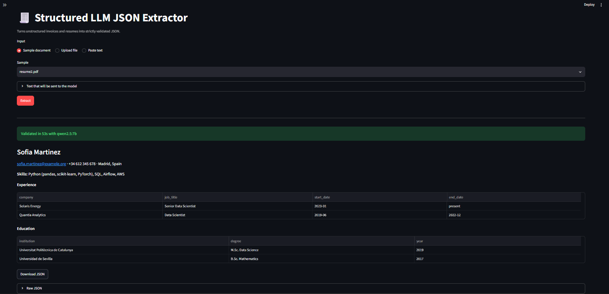
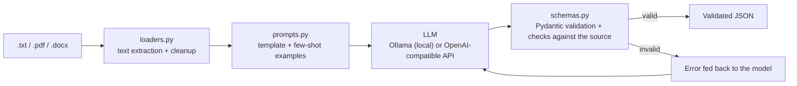

# Task 1: Structured LLM Prompt Pipeline & JSON Extractor

Turns messy, unstructured documents (invoices and resumes, as `.txt`, `.pdf` or `.docx`) into
**strictly validated JSON**. It runs fully locally and for free with [Ollama](https://ollama.com), and can
optionally call any OpenAI-compatible API.



## Why validation matters

An LLM returns *plausible* text, not guaranteed-correct data. During development this pipeline caught:

- a model that listed **VAT as a purchased item**,
- a model that **invented a total** (22.00) to make the arithmetic work, when the document said 99.00,
- a model that read "200 pcs" inside a product description as the **quantity**,
- a model that returned `email: null` although the email was in the text,
- a model that **copied an employer from a few-shot example** into a CV that listed no jobs (example leakage),
- a model that copied the **total of an example invoice** when it was given a resume instead of an invoice,
- a model that put a **grade ("75.09") and a language level ("B1") into the graduation-year field**,
- a model that wrote the **text** "null" instead of a real null,
- a local model that got stuck generating forever, which is why every call has a timeout and an output cap.

Each of these is now caught by a validator or a safety limit, and the exact error is sent back to the model so it can correct itself.

## How it works



1. **Structured output**: the JSON schema is sent to the model, so the answer has the right shape.
2. **Pydantic validation**: types, `YYYY-MM-DD` dates, 3-letter currency codes, valid emails, 4-digit years.
3. **Business rules**: line items - discount + tax must equal the total.
4. **Grounding checks**: every amount, invoice number, email and company must literally appear in the source text, so the model cannot invent or "fix" values.
5. **Retry loop**: on failure, the validation error is fed back to the model (up to 3 attempts), then the pipeline stops with a clear message instead of returning bad data.
6. **Safety limits**: a timeout per call and a cap on output length, so a stuck model cannot hang the program.

## Setup

1. Install Python 3.10+ and [Ollama](https://ollama.com/download).
2. Download a model: `ollama pull qwen2.5:7b` (about 5 GB; `llama3.2:3b` is a faster, lighter option).
3. Install the dependencies:
   ```bash
   python -m venv venv
   venv\Scripts\activate            # Windows  (macOS/Linux: source venv/bin/activate)
   python -m pip install -r requirements.txt
   ```

## Usage

```bash
python extractor.py --file samples/invoices/invoice2.txt --type invoice
python extractor.py --file samples/resumes/resume2.pdf --type resume --output result.json
python extractor.py --file samples/resumes/resume1.txt --type resume --model llama3.2:3b
python run_samples.py                    # runs every sample, saves outputs/<model>/ and a summary table
python run_samples.py --model llama3.2:3b
```

### Web UI (Streamlit)

```bash
streamlit run app.py
```

Choose invoice or resume, pick a sample, upload a file or paste text, and view the validated result as tables,
with a JSON download and a log of every problem the validators caught and the model fixed.

### Using an API instead of Ollama (optional)

```bash
python -m pip install openai
set OPENAI_API_KEY=your_key            # Windows (macOS/Linux: export OPENAI_API_KEY=...)
python extractor.py --file samples/invoices/invoice1.txt --provider openai --model gpt-4o-mini
```

For Gemini, set `OPENAI_BASE_URL=https://generativelanguage.googleapis.com/v1beta/openai/` and use a Gemini key as
`OPENAI_API_KEY`. **Note:** this API path is implemented but was **not tested** by the author (no API access);
the Ollama path is fully tested.

## Example

Input:
```
INVOICE #2291 - Brightline Supplies Ltd.
Date: March 4th, 2026
3x Office chairs @ 85.00 each... 255.00
1 Standing desk 310
VAT 21%: 118.65   TOTAL: 683.65 EUR
```

Output:
```json
{
  "vendor": "Brightline Supplies Ltd.",
  "invoice_number": "2291",
  "date": "2026-03-04",
  "currency": "EUR",
  "line_items": [
    {"description": "Office chairs", "quantity": 3.0, "unit_price": 85.0},
    {"description": "Standing desk", "quantity": 1.0, "unit_price": 310.0}
  ],
  "discount": 0.0,
  "tax": 118.65,
  "total": 683.65
}
```

## Results on the 10 sample documents

Six invoices (US, UK and German layouts, one with a discount, one with shipping, one deliberately inconsistent)
and PDF, text and informal resumes. CPU only, 16 GB RAM.

| Model | Passed | Time per document |
|---|---|---|
| llama3.2:3b | 9/10 | roughly 10-20 s |
| qwen2.5:7b | 10/10 | roughly 20-65 s |

`broken_total.txt` is intentionally inconsistent and is **expected to be rejected**; both models pass that test.
The 3B model failed `resume2.txt` by repeatedly returning `email: null`, and earlier misread a pack size
as a quantity on `invoice2.txt`. Larger models handled both.

## Known limitations

- Scanned (image-only) PDFs are not supported; there is no OCR.
- Decorative multi-column PDF templates (CVs with skill bars) are extracted in a scrambled order, which hurts
  accuracy and can take around 2 minutes per document on CPU.
- Small local models can still miss items on unusual layouts; larger models are more reliable.
- The sample set is small and synthetic, so it is not a statistical benchmark.
- Two document types are supported (invoice, resume). A new type needs a schema and a prompt configuration.

## Project structure

```
schemas.py       Pydantic models, validators and checks against the source text
prompts.py       prompt templates and few-shot examples
loaders.py       .txt / .pdf / .docx text extraction and cleanup
extractor.py     LLM calls, retry loop, command-line interface
run_samples.py   batch runner and model comparison
app.py           Streamlit web UI
samples/         fictional invoices and resumes (no real personal data)
outputs/         saved results per model
```
